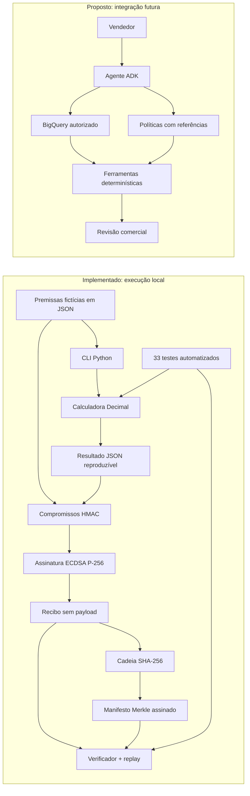

# Gemini Enterprise + Cymbal Labs

**Um estudo executável de ROI para um agente empresarial, concebido por Alex Bolson, Founder & Chief Architect da FoundLab.**

> *Infrastructure for Auditable Trust*
>
> **Trust by physics, not by policy.**

Eu vim do direito, com foco em integridade de mercado e compliance. Hoje construo infraestrutura para que confiança seja demonstrada por evidências, não apenas declarada. Neste estudo, apliquei essa visão a um problema concreto: um motor de ROI determinístico, recibos criptográficos verificáveis e uma arquitetura proposta para Gemini Enterprise, ADK, BigQuery e RAG.

**A fronteira importa:** cálculo, recibos ECDSA, cadeia de hashes e lote Merkle estão implementados localmente; o agente em nuvem e a gestão de chaves de produção, não. O projeto demonstra mecanismos criptográficos, mas não afirma identidade organizacional, retenção imutável, trusted timestamp ou zero-persistence do host.

> **A ideia central:** deixe o modelo explicar; deixe a matemática determinística calcular.

## Comece localmente

Requer Python 3.10+. O cálculo de ROI usa apenas a biblioteca padrão; os recibos criptográficos e a suíte completa usam `cryptography`.

```bash
python -m venv .venv
```

**Windows PowerShell**

```powershell
.\.venv\Scripts\python.exe -m pip install -r requirements.txt
.\.venv\Scripts\Activate.ps1
```

**macOS / Linux**

```bash
.venv/bin/python -m pip install -r requirements.txt
source .venv/bin/activate
```

Após ativar o ambiente, execute `python demo.py examples/roi_input.json` e `python -m unittest discover -s tests -v`. O cálculo de ROI não precisa de credenciais, rede ou serviços Google Cloud; a emissão criptográfica exige chaves fornecidas pelo operador. O exemplo compara dois cenários fictícios em BRL; a saída esperada está em [`examples/roi_output.expected.json`](examples/roi_output.expected.json).

| Cenário | Investimento | Resultado líquido em 3 anos | ROI simples | Payback |
| --- | ---: | ---: | ---: | ---: |
| Configuração A | R$ 1.000.000 | R$ 500.000 | 50,00% | 24 meses |
| Configuração B | R$ 1.200.000 | R$ 600.000 | 50,00% | 24 meses |

Esses valores demonstram as fórmulas, não preveem resultados de uma empresa real. As premissas e limitações estão em [garantias e limites](docs/04-garantias-e-limites.md).

## O que está demonstrado

- **Cálculo determinístico:** `Decimal`, arredondamento explícito e fórmulas versionadas.
- **Contrato estrito de entrada:** rejeita valores inválidos, cenários incompatíveis, campos desconhecidos e chaves JSON duplicadas.
- **CLI utilizável por automação:** JSON UTF-8 em `stdout`, erros em `stderr` e código de saída não zero para entradas inválidas.
- **Recibo criptográfico:** DecisionID aleatório, compromissos HMAC para entrada e resultado, assinatura ECDSA P-256 e encadeamento SHA-256 opcional.
- **Verificador independente:** recalcula o resultado, verifica compromissos, assinatura, fingerprint confiável e links da cadeia sem receber o payload dentro do recibo.
- **Provas Merkle:** manifesto em lote assinado, hashes com separação de domínio e prova de inclusão por recibo.
- **Testes reproduzíveis:** casos conhecidos, arredondamento, payback, cenários inválidos e execução ponta a ponta da CLI.
- **Projeto de sistema:** fontes, premissas, arquitetura, controles de segurança e plano de integração documentados.
- **Integração contínua pronta para publicação:** o workflow executa a suíte em várias versões do Python e também no Windows.

## O que não está implementado

| Componente | Estado |
| --- | --- |
| Calculadora de ROI e CLI local | Implementadas e cobertas por testes |
| Agente ADK e ferramentas proprietárias | Propostos; não implementados |
| Consultas a BigQuery e recuperação RAG | Desenhadas; sem integração real |
| Gemini Enterprise e Agent Runtime | Sem registro, configuração ou implantação |
| KMS/HSM, rotação e revogação de chaves | Não integrados; chaves locais são apenas para demonstração |
| Algoritmo de otimização | Não fornecido nem simulado |
| Dados de clientes ou resultados de produção | Não utilizados |

Essa separação é intencional: um diagrama de arquitetura não é prova de deployment, e uma projeção aritmética não é garantia de retorno.

## Por que publiquei este estudo

Em sistemas regulados, dizer que uma decisão é confiável não basta: é preciso mostrar de onde veio, como foi calculada e o que ainda não se sabe. Este exemplo exercita essa disciplina em escala reduzida:

- premissas ficam visíveis junto aos cenários;
- o resultado financeiro vem de código determinístico, não de texto gerado;
- entradas fora do contrato falham explicitamente;
- testes com resultados conhecidos tornam o cálculo reproduzível;
- a documentação separa evidência local de arquitetura futura.

Isso demonstra uma implementação local com verificação criptográfica — não uma certificação, gestão de chaves de produção, retenção imutável ou garantia regulatória.

## Arquitetura em duas partes



O cálculo, emissão/verificação de recibos, encadeamento e prova de inclusão Merkle rodam localmente. O fluxo à direita é um desenho sujeito a implementação e validação no ambiente de destino. Veja [arquitetura e responsabilidades](docs/03-arquitetura.md).

## Emitir e verificar evidência

O recibo contém identificadores, versões, compromissos HMAC e assinatura — nunca o JSON original nem o resultado financeiro. Para verificar, o auditor precisa do JSON original, da chave pública confiável e da chave HMAC autorizada. Os hashes HMAC não são públicos nem substituem controle de acesso.

Gere as chaves fora deste repositório, em diretório protegido ou gestor de segredos. Exemplo local com OpenSSL:

```bash
# Gere uma chave privada P-256 protegida por senha e a chave pública correspondente.
openssl ecparam -name prime256v1 -genkey -noout |
  openssl pkcs8 -topk8 -v2 aes-256-cbc -out signing-private.pem
openssl pkey -in signing-private.pem -pubout -out signing-public.pem
```

Crie uma chave HMAC de pelo menos 32 bytes em um gestor de segredos aprovado; não a salve no repositório. Para dados fictícios, `openssl rand -out commitment.key 32` cria uma chave local ignorada pelo Git. Defina `FOUNDLAB_SIGNING_PASSWORD` no ambiente protegido para desbloquear o PEM.

```bash
python evidence_cli.py fingerprint signing-public.pem
python evidence_cli.py issue examples/roi_input.json --signing-key signing-private.pem --signing-key-password-env FOUNDLAB_SIGNING_PASSWORD --commitment-key commitment.key --commitment-key-id local-demo-v1 --output decision.receipt.json

python evidence_cli.py verify examples/roi_input.json decision.receipt.json --public-key signing-public.pem --trusted-signing-key-id sha256:COLOQUE_AQUI_O_FINGERPRINT_CONFIAVEL --commitment-key commitment.key --commitment-key-id local-demo-v1
```

Substitua o fingerprint de exemplo pelo valor validado por canal confiável; não confie em uma chave só porque veio junto do recibo. A emissão local não prova horário, identidade organizacional ou retenção imutável. Consulte o [guia de verificação](docs/10-verificacao-de-evidencias.md) e o [modelo de ameaças](docs/09-modelo-de-ameacas.md) antes de usar chaves reais.

Use `--previous-receipt` para encadear eventos. `merkle-build` e `merkle-verify` criam um manifesto assinado e verificam a inclusão de um recibo em lote.

## Como o ROI é calculado

Para o investimento inicial `I`, benefícios anuais `B[t]` e custos operacionais anuais `C[t]`:

```text
resultado_liquido = soma(B[t] - C[t]) - I
roi_percentual = (resultado_liquido / I) * 100
```

O payback simples é interpolado dentro do primeiro ano em que o fluxo líquido acumulado recupera o investimento. Se isso não ocorrer no horizonte, o resultado é `null`. O cálculo não inclui VPL, TIR, impostos, inflação ou desconto temporal; benefícios precisam representar contribuição incremental sem dupla contagem.

## Mapa do projeto

```text
.
├── demo.py                 # interface de linha de comando
├── roi_model.py            # contrato e cálculo financeiro
├── evidence.py             # compromissos, recibos assinados e hash chain
├── evidence_cli.py         # emissão e verificação independente
├── merkle.py               # manifestos assinados e provas de inclusão
├── requirements.txt        # dependência criptográfica fixada
├── examples/               # entrada fictícia e resultado esperado
├── tests/                  # testes unitários e de integração da CLI
├── docs/                   # caso, ADRs, ameaças, fórmulas e verificação
├── MANIFEST.sha256         # hashes dos arquivos distribuíveis
├── sources/                # referências locais; PDFs são ignorados pelo Git
└── validation/             # registros da validação da entrega original
```

O manifesto não inclui a si próprio, os PDFs ignorados nem arquivos temporários do Python.

| Leitura | Para entender |
| --- | --- |
| [O caso Cymbal Labs](docs/02-cymbal-labs.md) | Contexto fictício e objetivo de negócio |
| [Arquitetura](docs/03-arquitetura.md) | Componentes, responsabilidades e falhas |
| [Garantias e limites](docs/04-garantias-e-limites.md) | Contrato de entrada, fórmulas e segurança |
| [Plano de integração](docs/05-plano-de-integracao.md) | O que precisaria ser construído e validado |
| [Fontes e proveniência](docs/06-fontes.md) | Referências técnicas e direitos do material |
| [Decisões arquiteturais](docs/08-decisoes-arquiteturais.md) | Por que o motor, recibo e cadeia foram desenhados assim |
| [Modelo de ameaças](docs/09-modelo-de-ameacas.md) | Ativos, fronteiras, ameaças e riscos residuais |
| [Guia de verificação](docs/10-verificacao-de-evidencias.md) | Fluxo de emissão, validação e limites criptográficos |
| [Registro de afirmações](docs/claim-ledger.csv) | Evidência e escopo das afirmações |

## Executar e validar

```bash
# Calcular e imprimir JSON
python demo.py examples/roi_input.json

# Emitir ou validar recibos (chaves externas, não incluídas no repositório)
python evidence_cli.py --help

# Executar todos os testes
python -m unittest discover -s tests -v
```

O workflow instala `requirements.txt` e executa a suíte em Python 3.10–3.14 no Linux e Python 3.12 no Windows. Nenhuma execução em Google Cloud faz parte deste projeto.

## Publicação

A Cymbal Labs e os números são fictícios. Os documentos e o código não representam uma integração aprovada pelo Google nem aconselhamento financeiro. Os recibos locais não substituem infraestrutura de chaves confiável, trilha imutável ou análise de segurança. Os PDFs fornecidos como referência são ignorados pelo Git; confirme os direitos de redistribuição antes de incluí-los manualmente em um repositório público. Nenhum arquivo de licença foi criado.

## Sobre mim

Sou Alex Bolson, Founder & Chief Architect da [FoundLab](https://foundlab.com.br/). Trabalho em infraestrutura de confiança auditável para sistemas financeiros e de IA regulada. Minha experiência anterior como advogado, com atuação em integridade de mercado e compliance, influencia uma regra de engenharia que aplico aqui: cada afirmação técnica deve ter evidência e escopo claros.

- [LinkedIn](https://linkedin.com/in/alex-bolson-941b1925a)
- [Secrecy Architecture](https://github.com/irelia0nerf/secrecy-architecture) — arquitetura de referência para sistemas de sigilo verificável
- [Veritas Protocol](https://github.com/irelia0nerf/foundlab-research) — pesquisa sobre evidência criptográfica para decisões financeiras
- [Mais projetos da FoundLab](https://github.com/irelia0nerf)

---

**Alex Bolson · FoundLab · Evidência antes de alegações.**
