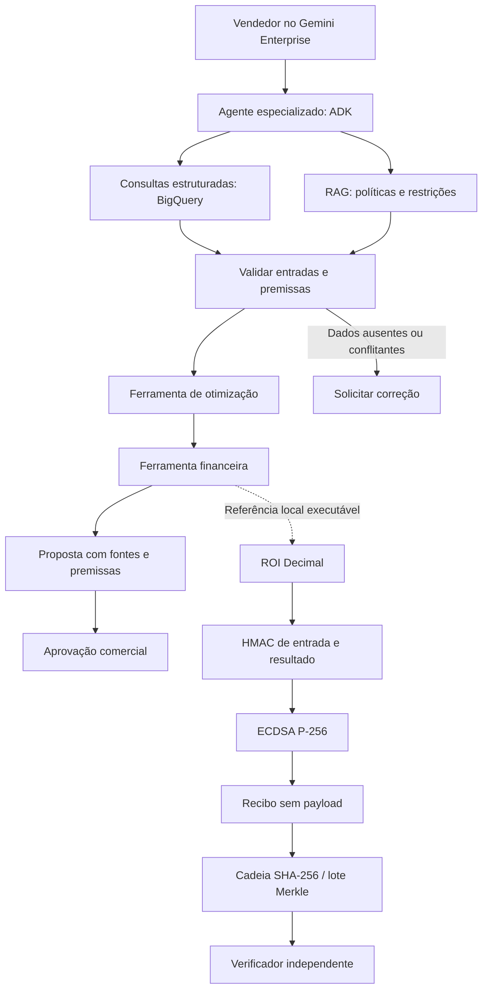

# Arquitetura proposta

**Estudo independente de Alex Bolson · FoundLab**

**Estado:** calculadora determinística, recibos assinados, verificador local, hash chain e manifesto Merkle estão implementados. A integração Google Cloud permanece proposta.

## Lente de engenharia FoundLab

Uso quatro princípios para avaliar a arquitetura, sem afirmar que o protótipo já os implementa por completo:

- **Determinismo:** cálculos financeiros são feitos por ferramenta numérica versionada, não improvisados pelo LLM.
- **Fail-closed:** ambiguidade, origem incerta ou dado ausente interrompem a análise em vez de produzir uma resposta com aparência definitiva.
- **Evidência antes de alegações:** fontes, atualidade, premissas, versão da fórmula e aprovação devem acompanhar uma decisão futura.
- **Minimização de dados:** preferir agregados e manter payload sensível fora de logs e traces sempre que possível.

O cálculo, os recibos criptográficos e os manifestos Merkle rodam localmente. Agente, fontes empresariais, zero-persistence garantido e controles cloud continuam como requisitos propostos, não capacidades validadas.

## Orquestração

O agente seria hospedado no runtime gerenciado. Sessões e memória são serviços com configuração e política de retenção próprias, não garantias automáticas de correção do workflow. [S5]

## Responsabilidades

| Camada | Responsabilidade | Condição de falha |
| --- | --- | --- |
| Interface | Receber solicitação e identificar o usuário | Identidade ou cliente indefinido: interromper consulta |
| Consulta estruturada | Obter números de fontes empresariais autorizadas | Dados ausentes, antigos ou de outro cliente: não emitir cálculo definitivo |
| RAG | Recuperar regras e textos relevantes com referências | Conflito ou fonte sem versão: pedir revisão |
| Otimização | Aplicar algoritmo e restrições aprovados | Configuração inviável: retornar inviabilidade explícita |
| Cálculo | Executar fórmulas versionadas | Entrada inválida: erro explícito; nunca substituir por zero |
| Geração | Explicar resultados e premissas | Não criar valores ausentes nem alterar os retornados pela ferramenta |
| Ação externa | Registrar ou enviar proposta após autorização | Ausência de autoridade: bloquear envio |

Essas condições são requisitos propostos para a futura integração, não controles Google Cloud testados neste pacote. O recibo criptográfico local está implementado para demonstrar um caminho de verificação; não autentica dados de fontes empresariais que ainda não existem nesta aplicação.

## Ferramentas previstas

Os nomes abaixo são interfaces conceituais internas, **não APIs oficiais nem funções já disponíveis**:

- `consultar_dados_cliente`: buscar agregados autorizados de uso e desempenho, com data e identificadores de origem.
- `recuperar_politicas`: localizar documentos aprovados e suas versões.
- `otimizar_configuracao`: aplicar o algoritmo proprietário a requisitos e restrições explícitos.
- `calcular_roi`: validar e calcular cenários; a implementação local de referência é `roi_model.calculate`.
- `preparar_proposta`: compor um rascunho a partir de dados e resultados das ferramentas.

Para valores financeiros estruturados, priorizar consultas tipadas e fórmulas aprovadas. O RAG serve para recuperar contexto documental, e não substitui a leitura exata das tabelas financeiras.

## Dados e segurança

Minimizar os dados utilizados: preferir agregados comerciais e operacionais. Este caso não exige enviar registros clínicos ou genômicos identificáveis ao modelo.

Na integração: definir IAM mínimo, escopo por cliente, política de saída, fontes permitidas, tratamento de prompt injection em documentos, redação de logs e retenção. VPC Service Controls pode complementar essas medidas para serviços suportados. [S8]

Não equiparar acesso de leitura a autorização de escrita. A decisão de publicar preço, conceder desconto ou enviar proposta deve passar pelas regras comerciais da organização.

## Observabilidade e evidência

O protótipo gera `DecisionID`, HMACs para entrada e resultado, assinatura ECDSA P-256 e recibos encadeáveis. Manifestos Merkle assinados podem agrupar recibos, com provas de inclusão. O payload original não é copiado para esses artefatos.

Na minha abordagem, telemetria operacional e evidência criptográfica têm funções distintas: traces ajudam a observar o sistema; não substituem recibos verificáveis. Este pacote não implementa OpenTelemetry, ledger imutável, isolamento entre tenants, trusted timestamp, integração KMS/HSM ou controles REX Guard. A cabeça da cadeia e a raiz Merkle ainda precisam de ancoragem externa para resistir a rollback.
